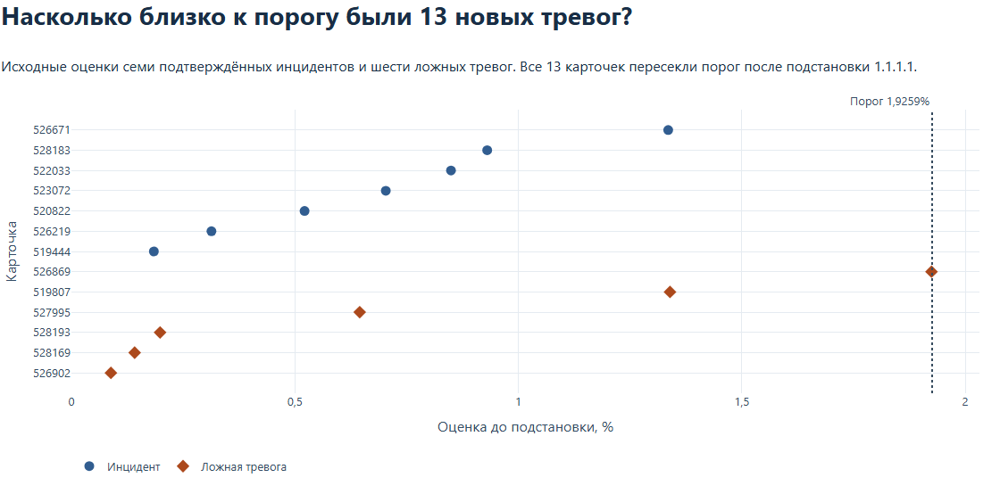

# Карточки SOC и качество прогнозов

Команда № 2 · группа 5140201/50302 · трек ML

Артём Волгузов, Владислав Коток, Евгений Романчук

Приложение на Taipy показывает поток карточек SOC, ошибки модели и причины отдельных прогнозов.

| Задание | Что показывает экран | Материалы |
|---|---|---|
| **1. Карточки SOC** | Дневной приток, типы карточек, заполненность вердиктов, ложные тревоги по правилам SIEM и длительность разбора | [Скриншот](docs/overview.jpg) |
| **2. Качество модели** | Ошибки по категориям и неделям, выбор порога, соответствие оценок наблюдаемым частотам и сравнение с правилом «всё легитимно» | [Скриншот](docs/quality.jpg) |
| **3. Объяснение решения** | Объяснения пропуска и ложной тревоги, сверка исходных полей и сравнение по 320 учебным карточкам | [Скриншот](docs/shap.jpg) · [Записка](docs/shap.pdf) |

[Отчёт по трём заданиям (PDF)](docs/report.pdf) · [Данные и запуск](#данные)

## 1. Поток карточек SOC

Чтобы спланировать работу смены, сравнили дневной приток, время разбора и число ложных тревог, связанных с каждым правилом.

**В какой день в SOC поступило больше всего карточек?** С 12 апреля 2024 года по 3 сентября 2025 года в SOC поступило 240 295 карточек. Каждый столбец на графике соответствует дню создания по московскому времени. Самый высокий столбец приходится на 14 июня 2024 года, когда поступило 4 689 карточек. По времени создания можно установить дату пика. Для объяснения его причины потребуются сведения о событиях этого дня.

**Какие типы карточек формируют поток?** В рейтинге по числу карточек лидируют «Выполнение подозрительной команды» (45 521) и «Общий Инцидент ИБ» (40 579). Горизонтальные полосы позволяют сопоставить шесть самых частых типов и прочитать их названия.

**Сколько времени проходит от взятия в работу до закрытия?** Чтобы оценить длительность разбора, сравнили время взятия и фактического закрытия каждой карточки. Для 144 407 карточек медиана составила **2,4 минуты**, а 90% интервалов уложились в **51,1 минуты**. Распределение показывает, что у 1 190 карточек прошли сутки или больше. В этот интервал входят паузы. У 61 784 карточек отсутствует хотя бы одна из двух дат, а у 34 104 нарушена последовательность создания, взятия и закрытия. Длительность по ним определить нельзя.

**У каких типов чаще отсутствует вердикт?** У шести самых частых типов разное число карточек, поэтому сравнили доли внутри каждого типа. У «Сканирования хоста» без вердикта **22 018 из 23 751 карточки (92,7%)**, по всем типам вместе таких карточек 54 870 (22,8%). Затем посмотрели, какие исходы записаны у конкретного правила. Среди 23 760 карточек, где единственным правилом указано `GL_FW_S04_Host_Port_Scan`, у 22 018 вердикт отсутствует, у 1 426 стоит `False Positive`, у 257 «Дубликат», у 57 «Решён» и у двух «Не решён». Записи позволяют посчитать явные ложные тревоги. Выяснить, почему поле осталось пустым, можно по истории обработки.

**Какие правила дают смене больше всего ложных тревог?** Для этого рейтинга взяли 150 675 карточек с явным вердиктом `False Positive` (62,7% потока). У 7 383 из них правило не указано. В 20 карточках записано несколько правил, поэтому каждую такую карточку учли по одному разу у каждого названного правила. По числу ложных тревог лидирует `Nad_Attacks` (**9 118**, включая одну карточку с двумя правилами), следом идёт `Nad_Attack_Active_Directory` (4 814). Длина полосы показывает, со сколькими ложными тревогами связано правило. Если цель смены состоит в сокращении их числа, настройки стоит начать проверять с `Nad_Attacks`.

Фильтр месяца на экране относится к дате создания. За сентябрь 2025 года в выгрузке видны первые три дня, 1 517 карточек и 78 карточек без вердикта.

## 2. Качество прогнозов

Руководителю смены нужно решить, какие карточки смотреть первыми и сколько тревог придётся проверить. Для оценки качества сравнили решения модели с известными исходами. Для оценки нагрузки посчитали все сигналы в журнале.

**Помогает ли модель обнаруживать инциденты?** В журнале с 4 сентября по 29 ноября 2025 года есть 19 393 прогноза, из них 15 839 сопоставлены с карточкой по номеру и имеют проверяемый вердикт в журнале. Здесь 1 666 вердиктов «Решён» обозначают инцидент, а 14 173 вердикта `False Positive` обозначают легитимное событие. При пороге 18% модель обнаружила **1 331 из 1 666 инцидентов**, пропустила 335 и подала 2 563 ложные тревоги. Матрица показывает все четыре сочетания решения модели и вердикта аналитика. Для сравнения применили к тем же карточкам правило «всё легитимно». Оно дало 89,5% верных решений против 81,7% у модели, поскольку 14 173 события были легитимными. При этом правило пропустило все 1 666 инцидентов. По оценке модели можно выбирать, какие карточки проверить в первую очередь. Автоматическое закрытие карточек ниже порога оставило бы без тревоги 335 инцидентов.

**В каких категориях сосредоточены пропуски?** Больше всего инцидентов модель пропустила в «Сетевой безопасности» (139 из 1 009). Доля пропусков здесь составила 13,8% при 20,1% по всем категориям. В «Управлении учётными записями» пропусков меньше, но без тревоги остались 47 из 50 инцидентов (94%). В «Подозрительной активности» пропущено 63 из 98 (64,3%). Поэтому на графике длина полосы показывает число пропусков, а рядом подписаны числитель, знаменатель и доля.

**Насколько стабильна доля пропусков по неделям?** При тех же 18% с 22 по 28 сентября пропущено **49 из 109** инцидентов (45,0%), а с 13 по 19 октября **20 из 363** (5,5%). Одна средняя за весь период скрывает этот разброс. Все недельные полосы используют общую шкалу, а подпись даёт размер каждой группы. Неделю определяем по московской дате прогноза. При выборе ноября известный исход есть у 6 546 из 9 948 прогнозов. С 24 по 29 ноября в журнале 2 118 прогнозов и ни одного известного исхода. В начале периода, с 4 по 7 сентября, известны три легитимных исхода. Доля пропусков определена для 11 из 13 недельных отрезков.

**Как часто подтверждаются инциденты в каждом диапазоне оценок?** Перед выбором порога сопоставили среднюю оценку и наблюдаемую долю инцидентов в каждом диапазоне. На диагонали эти величины совпадают. В диапазоне от 50% до 70% средняя оценка составила **58,8%**, но инцидент подтвердился лишь в **352 из 891** случаев (39,5%). Оценка в этой группе превосходит наблюдаемую частоту на 19,3 процентного пункта. Нижняя граница входит в диапазон, оценка 100% включена в последний. Переключение порога меняет решение о тревоге и сохраняет исходные оценки.

**Что получит смена при снижении порога с 18% до 10%?** Две линии на общей шкале показывают цену решения. При пороге 10% на той же проверяемой выборке было бы 230 пропусков вместо 335 и 4 258 ложных тревог вместо 2 563. Это **105 дополнительных найденных инцидентов и 1 695 дополнительных ложных тревог**. По всему журналу смена получила бы 2 276 дополнительных сигналов, в том числе 476 с неизвестным исходом. Именно этот объём нужно сопоставлять с возможностями смены.

## 3. Объяснения SHAP

В согласованном наборе № 2 восемь карточек, по две на каждый из четырёх исходов. Это обнаруженный инцидент, пропуск, ложная тревога и верное отклонение. Для практики 3.7 используется отдельная учебная модель LightGBM с порогом **1,9259%**. Порог 18% из журнала задания 2 к этой модели не применяется. На двух примерах проверим, согласуется ли объяснение с полями карточки, затем сравним его с похожими случаями. На диаграмме вклады полей складываются с базовым баллом в логарифмах шансов. Итог и порог показаны на одной шкале.

**Почему модель пропустила инцидент № 523952?** Оценка составила **0,00017%**. Сильнее всего балл снизило имя хоста источника. В исходном поле `src` адрес отсутствует, и долю частных IP вычислить нельзя. Перед масштабированием модель подставила в этот признак медиану обучающей выборки **1,0 (100%)**. Вклад признака составил −0,353. Трактовка этого вклада как свидетельства частного адреса сомнительна. Фактический адрес неизвестен. В той же категории «Подозрительная активность» адрес отсутствовал у 13 из 16 пропущенных инцидентов. Верно обнаруженных инцидентов этой категории в учебной выборке нет, поэтому расширили сравнение на все категории. Среди 320 карточек, куда поровну отобрали четыре исхода, адрес отсутствовал у **62 из 80 пропущенных** и **41 из 80 обнаруженных** инцидентов. Во всех 206 карточках без адреса вклад признака был отрицательным. Для № 523952 выбираем проверку данных и сверим поле с исходным событием. По пустому полю нельзя установить, был ли адрес частным.

**Помогает ли модели отдельный флаг «адрес пропущен»?** Четыре варианта LightGBM обучили на одних и тех же карточках за июнь, июль и август 2025 года. Для проверки взяли 19 924 размеченные карточки с 1 сентября по 20 ноября, включая 2 127 инцидентов. Все модели сравнили при общем пороге 1,9259%. В основном запуске у модели с дополнительным флагом число обнаруженных инцидентов выросло с **1 789 до 1 792**, а число ложных тревог снизилось с **2 819 до 2 739**.

Для карточек с пустым `src` результат другой. Из 1 305 инцидентов исходная модель обнаружила **1 008**, модель с флагом **1 005**. Шесть дополнительных обнаружений на карточках с указанным адресом дали общий прирост в три инцидента. При трёх запусках на одном разбиении флаг изменил число обнаружений в группе с пустым адресом на **−3, +8 и +1**. Флаг во всех случаях совпал с условием `len_src == 0`. Сохраняем исходную модель. Флаг дублирует уже доступную информацию, а устойчивого сокращения пропусков при пустом адресе не получили.

[Как повторить обучение](experiments/src_missing/README.md#как-воспроизвести) · [Код эксперимента](experiments/src_missing/compare_models.py) · [Сводные результаты всех запусков](experiments/src_missing/metrics.csv)

<details>
<summary>Четыре варианта модели при пороге 1,9259%</summary>

В основном запуске использовали настройки обучения версии v001 и получили те же оценки у исходной модели. В остальных запусках меняли только инициализацию случайных чисел.

| Признаки | Обнаружено из 2 127 | Пропущено | Ложные тревоги |
|---|---:|---:|---:|
| Исходные признаки v001 | 1 789 | 338 | 2 819 |
| Добавлен флаг пустого адреса | 1 792 | 335 | 2 739 |
| Убрана доля частных IP | 1 773 | 354 | 2 604 |
| Доля частных IP заменена флагом | 1 784 | 343 | 2 860 |

</details>

**Почему по карточке № 527002 возникла ложная тревога?** Итоговая оценка **2,08942%** превысила порог, хотя аналитик признал событие легитимным. Исходные данные подтверждают значение признака. В карточке один внешний адрес, поэтому доля частных IP равна нулю. Этот признак повысил балл на 1,981, поле алерта ещё на 1,870. Чтобы понять, характерен ли первый вклад для ложных тревог, сравнили карточки «Сетевой безопасности» только с внешними адресами источника. Средний вклад составил **+2,560 у 12 ложных тревог** и **+2,684 у 27 верных**. Признак в среднем повышал балл в обеих группах. В основном запуске при том же пороге модель без доли частных IP дала на 215 ложных тревог меньше, но пропустила ещё 16 инцидентов. Для обнаружения инцидентов сохраняем этот признак.

В приложении переключитесь с № 523952 на № 527002 и разверните «Как проверить расчёт по исходным полям». Приложение суммирует вклады закодированных признаков по 73 исходным полям. Для каждой карточки доступны значения полей, десять ведущих вкладов и сверка суммы с баллом модели.

**Какие поля сильнее всего влияют на балл в среднем?** Чтобы понять, насколько два примера типичны, сравнили величину вкладов по всем полям. По 320 учебным карточкам первые три места занимают имя хоста источника, имя хоста цели и доля частных IP источника. За ними идут частота наименования и поле команды. Полосы упорядочены по среднему абсолютному вкладу SHAP. Противоположные по знаку вклады при таком подсчёте не гасят друг друга. Порядок полей зависит от состава выборки.

**Как меняется средняя оценка с длиной сообщения?** Текст алерта повысил балл обеих карточек, но у вычисленной длины сообщения вклады разных знаков (−0,168 у № 523952 и +0,298 у № 527002). На графике частичной зависимости (PDP) по 3 173 записям меняем только значение признака длины, сохраняя остальные признаки каждой записи. При нулевой длине средняя оценка составляет 12,14%, при 55 словах 12,34%. Разница между крайними точками всего 0,20 процентного пункта.

### Как адрес источника влияет на решение?

Для 1 152 размеченных карточек с внешним адресом, поступивших после обучения, сравнили прогнозы при сохранении и удалении поля `src`. Без адреса изменились 27 решений. Модель обнаружила 763 из 788 инцидентов вместо 777, а число ложных тревог снизилось с 278 до 277. Для этой модели сохраняем записанный адрес. Пустое поле в карточке остаётся поводом свериться с исходным событием.

<details>
<summary>Сравнение на карточках с известным исходом и воспроизведение расчёта</summary>

В исходной выгрузке 259 218 уникальных карточек. В 42 052 из них в src записан хотя бы один публичный адрес IPv4 или IPv6. Групповые и зарезервированные адреса исключили. Сюда входят 285 карточек со смешанным списком адресов. У 15 835 карточек с внешним src аналитик поставил «Решён» или «False Positive».

На каждой карточке сравнили исходный прогноз LightGBM v001 с прогнозом после удаления всего поля src. Модель заново вычислила число адресов, их состав и остальные признаки, зависящие от src. Для обоих прогнозов действует порог 1,9259%. Вердикт аналитика в этом учебном наборе задаёт правильный ответ. Ложная тревога означает, что модель подала сигнал на карточке с вердиктом «False Positive». Окно обучения модели охватывает июнь, июль и август 2025 года. Отдельно взяли карточки с 1 сентября по 20 ноября 2025 года, которые поступили позже этого окна. В сводку за весь период входят и карточки периода обучения.

| Карточки с внешним src | Ложные тревоги среди легитимных | Ложные среди поданных тревог на размеченных | Изменилось решений после удаления src |
|---|---:|---:|---:|
| Вся выгрузка | 2 992 из 8 932 (33,5%) | 2 992 из 9 206 (32,5%) | 2 104 из 15 835 (13,3%) |
| После обучения | 278 из 364 (76,4%) | 278 из 1 055 (26,4%) | 27 из 1 152 (2,3%) |
| Учебная выборка из 320 | 24 из 26 (92,3%) | 24 из 62 (38,7%) | 1 из 70 (1,4%) |

Если считать все размеченные карточки с внешним src, исходная ложная тревога пришлась на 2 992 из 15 835 (18,9%) за весь период и на 278 из 1 152 (24,1%) после обучения.

| Переходы на размеченных карточках с внешним src | Весь период | После обучения |
|---|---:|---:|
| Тревога исчезла у легитимной карточки | 1 137 | 5 |
| Появилась новая ложная тревога | 99 | 4 |
| Модель перестала обнаруживать инцидент | 853 | 16 |
| Модель обнаружила прежний пропуск | 15 | 2 |

После обучения число ложных тревог на размеченных карточках с внешним src изменилось с 278 до 277, число обнаруженных инцидентов с 777 до 763. После удаления адреса модель дала на одну ложную тревогу меньше и обнаружила на 14 инцидентов меньше. Сравнение показывает, как удаление информации меняет решение фиксированной модели на тех же событиях.

**Какие инциденты сменили решение после удаления src?** У всех 788 подтверждённых инцидентов этого периода в поле src был один внешний адрес. Модель обнаруживала 777 из них. После удаления src она потеряла 16 прежних обнаружений и получила 2 новых. Остальные 9 смен решений пришлись на легитимные события. Исчезли 5 ложных тревог и появились 4.

| Результат без src | Что объединяет карточки | Оценка модели до и после |
|---|---|---|
| 16 прежних обнаружений потеряны | 13 карточек относятся к сетевой безопасности. Из них 6 связаны с правилом Nad_Possible_Scan_Activity, 5 с Nad_Possible_Attack_Detected и 2 с Nad_Possible_Dangerous_Tools_Usage. В группе 15 разных адресов источника. | Медиана снизилась с 19,33% до 1,02% при пороге 1,9259%. До удаления оценки лежали в диапазоне от 3,48% до 88,18%. |
| 2 прежних пропуска обнаружены | В обеих карточках один и тот же внешний источник, по два разных адреса назначения и одно правило TTS_12_Exploit_Usage_Attempt. | У № 526702 оценка выросла с 0,2103% до 2,6436%. У № 528280 с 0,9708% до 23,6495%. |

Сетевая безопасность преобладает и среди 761 инцидента, обнаруженного в обоих прогонах (594 карточки). Медиана исходной оценки в группе из 761 карточки составляла 97,44%. По правилу TTS_12_Exploit_Usage_Attempt зарегистрировано 70 подтверждённых инцидентов. Тревога сохранилась в 66 случаях, исчезла в двух и появилась в двух. Две новые тревоги относятся к одному источнику, поэтому переносить этот результат на другие источники рано.

**Вывод.** На этом периоде модель после удаления src обнаружила 763 из 788 инцидентов (96,83%) вместо 777 (98,60%). При этом число ложных тревог сократилось всего на одну. При выборе между двумя проверенными вариантами для этой версии модели сохраняем записанный src. Опыт оценивает совместный эффект поля и вычисляемых из него признаков.

[Сводные результаты по группам](source_removal_summary.csv)

На всех размеченных карточках независимо от вида адреса удаление src изменило 2 736 из 197 746 решений (1,4%). С учётом карточек с неопределённым исходом решение изменилось у 4 168 из 259 218 (1,6%). У карточек с уже пустым полем оба входа совпадают. Среди 26 217 карточек с внешним адресом и другими или отсутствующими вердиктами решение изменилось у 1 365. Назвать их тревоги верными или ложными по выгрузке нельзя. Учебные 320 карточек отобраны поровну по четырём исходам, поэтому их доли зависят от способа отбора. За весь период вердикты есть у 37,7% карточек с внешним адресом, после обучения у 97,4%. Поэтому разницу частот между периодами нельзя целиком приписать модели.

Исходные решения совпали с эталонными по всем 320 учебным и 80 контрольным карточкам. У одной контрольной карточки исходная оценка при пересчёте отличается от записанной примерно на 0,00037 процентного пункта. Обе оценки ниже порога.

Чтобы получить таблицу с парными оценками для 27 карточек, скачайте полную выгрузку в папку `data` и выполните команду в окружении задания 3. Она сохранит результат локально в файле `source_removal_changes.csv`. [Полная выгрузка курса](https://disk.yandex.ru/d/waiZmiOzun8EZA/Datasets/%D0%97%D0%B0%D0%B4%D0%B0%D0%BD%D0%B8%D0%B5%202%3A%20%D0%98%D0%BD%D1%84%D0%B5%D1%80%D0%B5%D0%BD%D1%81%20%D0%BC%D0%BE%D0%B4%D0%B5%D0%BB%D0%B8/%D0%9F%D0%BE%D0%B4%20%D0%BE%D0%B1%D1%83%D1%87%D0%B5%D0%BD%D0%B8%D0%B5/iavd_ml_dataset.parquet) · [Сводные количества по группам](source_removal_summary.csv) · [Расчёт](source_removal.py)

```powershell
python source_removal.py data/iavd_ml_dataset.parquet --changes source_removal_changes.csv
```

</details>

<details>
<summary>Как проверяли влияние адреса на карточке № 523952 и в учебной выборке</summary>

Изменится ли решение, если указать адрес? В двух копиях № 523952 заменили только поле `src` и заново пропустили обе карточки через модель v001. Вместе с полем изменяются зависящие от него признаки, в том числе число адресов. Порог во всех трёх случаях равен **1,9259%**.

| Адрес источника | Оценка модели | Решение |
|---|---:|---|
| Исходная карточка, адрес отсутствует | 0,000167% | Без тревоги |
| Частный `10.0.0.1` | 0,000154% | Без тревоги |
| Внешний `1.1.1.1` | 0,001905% | Без тревоги |

При частном адресе оценка немного снизилась. При внешнем она выросла примерно в 11,4 раза относительно исходной. В обоих сценариях оценка осталась ниже порога. Модель пропустила бы этот подтверждённый инцидент при каждой из двух подстановок. Фактический адрес источника остаётся неизвестным.

**Сколько решений изменится на всех карточках с пустым адресом?** Без `src` оказались 206 из 320 карточек. Среди них 103 подтверждённых инцидента. В исходном прогоне модель обнаружила 41 и пропустила 62. Для каждой из 206 карточек отдельно проверили те же два адреса, пересчитали признаки и сравнили решения при пороге 1,9259% с исходным прогнозом и вердиктом аналитика.

| Что изменилось | Частный `10.0.0.1` | Внешний `1.1.1.1` |
|---|---:|---:|
| Изменилось решений из 206 | 11 | 14 |
| Обнаружено из 62 прежних пропусков | 0 | 7 |
| Появилось пропусков инцидентов | 1 | 0 |
| Появилось ложных тревог | 0 | 6 |
| Снято ложных тревог | 10 | 1 |

С частным адресом все 11 изменений оказались снятыми тревогами, включая одну верную. С внешним адресом модель обнаружила 7 из 62 прежних пропусков (11,3%) и сохранила все 41 исходное обнаружение. При этом появились шесть ложных тревог, а одна прежняя ложная тревога исчезла. В учебной выборке по 80 карточек каждого исхода. Такой эксперимент показывает чувствительность решений к двум конкретным адресам. Реальные адреса этих карточек остаются неизвестными.

**Насколько близко к порогу были 13 новых тревог при подстановке внешнего адреса?** У 7 обнаруженных инцидентов медиана исходной оценки равна 0,7034%, у 6 новых ложных тревог 0,4217%. До порога 1,9259% этим группам не хватало в медиане 1,2224 и 1,5041 процентного пункта. У всех 13 вместе медиана исходной оценки равна 0,6451%, у остальных 110 карточек с пустым `src`, которые остались без тревоги, всего 0,0156%.

В пределах 0,5 процентного пункта от порога была только ложная тревога № 526869. Её исходная оценка 1,9245% отличалась от порога на 0,0014 пункта. Ближайшему из подтверждённых инцидентов, № 526671, не хватало 0,5905 пункта. Девяти из 13 карточек до порога не хватало больше одного пункта.

Семь обнаруженных инцидентов относятся к семи разным правилам. Среди шести ложных тревог по две дали правила TTS_10.1_Malware_Found_And_Not_Deleted и GL_IDS_S02_High_Number_Of_Attacks. Первое правило также встретилось у одного подтверждённого инцидента. Среди новых тревог по четыре карточки относятся к категориям «Вредоносное ПО» и «Подозрительная активность». В первой группе два инцидента и две ложные тревоги, во второй один инцидент и три ложные тревоги.



<details>
<summary>Все 13 карточек, оценки и правила SIEM</summary>

| Карточка | Новая тревога | До, % | До порога, п. п. | После, % | Правило SIEM |
|---|---|---:|---:|---:|---|
| 526671 | Инцидент | 1,3353 | 0,5905 | 3,8460 | `MTE_T1114.001_Email_Collection.Local_Email_Collection` |
| 528183 | Инцидент | 0,9303 | 0,9956 | 3,7938 | `TTS_09_Multiple_Malware_Found_In_Host` |
| 522033 | Инцидент | 0,8493 | 1,0766 | 14,9296 | `TTS_10.1_Malware_Found_And_Not_Deleted` |
| 523072 | Инцидент | 0,7034 | 1,2224 | 4,1092 | `GSOC_Successful_logged_in_after_bruteforce_on_SOC` |
| 520822 | Инцидент | 0,5217 | 1,4042 | 8,2498 | `Nad_Possible_Scan_Activity` |
| 526219 | Инцидент | 0,3133 | 1,6126 | 2,2302 | `MTE_T1134_Access_Token_Manipulation` |
| 519444 | Инцидент | 0,1845 | 1,7414 | 2,6718 | `MTE_T1112_Modify_Registry` |
| 526869 | Ложная тревога | 1,9245 | 0,0014 | 3,8636 | `Nad_Possible_Policy_Exploitation` |
| 519807 | Ложная тревога | 1,3394 | 0,5865 | 5,4934 | `MTE_T1569.002_System_Services.Service_Execution` |
| 527995 | Ложная тревога | 0,6451 | 1,2808 | 5,7365 | `TTS_10.1_Malware_Found_And_Not_Deleted` |
| 528193 | Ложная тревога | 0,1984 | 1,7275 | 3,9498 | `GL_IDS_S02_High_Number_Of_Attacks` |
| 528169 | Ложная тревога | 0,1415 | 1,7844 | 2,3653 | `GL_IDS_S02_High_Number_Of_Attacks` |
| 526902 | Ложная тревога | 0,0884 | 1,8375 | 2,3357 | `TTS_10.1_Malware_Found_And_Not_Deleted` |

</details>

**Чем различаются три новые тревоги по правилу `TTS_10.1_Malware_Found_And_Not_Deleted`?** У № 522033 аналитик указал четыре вредоносных файла в кэше браузера и подтвердил их удаление. В № 527995 тоже фигурировал кэш браузера, но проверка хэша по источникам сведений об угрозах не дала подтверждения. Событие закрыли как ложную тревогу. № 526902 аналитик описал как повторяющееся шумное срабатывание. В выгрузке у № 522033 указан Kaspersky и заполнено поле «Алерт». У двух карточек с вердиктом False Positive оба поля пусты.

Почему после одинаковой подстановки оценка выросла во всех трёх случаях? Для каждой карточки вычли исходный вклад SHAP из вклада после изменения адреса. Положительная разница означает, что признак сдвинул балл вверх. Вклады измерены в логарифмах шансов, оценки модели приведены в процентах.

| Карточка | Вердикт аналитика | Оценка до | Оценка после | Изменение балла |
|---|---|---:|---:|---:|
| 522033 | Инцидент | 0,8493% | 14,9296% | +3,0198 |
| 527995 | Ложная тревога | 0,6451% | 5,7365% | +2,2378 |
| 526902 | Ложная тревога | 0,0884% | 2,3357% | +3,2974 |

Во всех трёх случаях доля частных IP источника до подстановки была неизвестна. При подготовке данных модель подставляла обучающую медиану 1,0. С адресом 1.1.1.1 доля стала равна 0. Изменились поле src и три вычисленных признака. Модель пересчитала число элементов в списке src, число распознанных IP и долю частных адресов. В деревьях вклад одного поля зависит от значений других, поэтому SHAP изменился и у полей, значения которых остались прежними.

<details>
<summary>Три крупнейших положительных изменения SHAP у каждой карточки</summary>

| Карточка | Признак | Вклад до | Вклад после | Изменение |
|---|---|---:|---:|---:|
| 522033 | Доля частных IP источника | −0,3999 | 2,6844 | +3,0842 |
| 522033 | Имя хоста источника | 0,6831 | 0,7833 | +0,1002 |
| 522033 | Имя хоста цели | 0,1923 | 0,2875 | +0,0952 |
| 522033 | Остальные поля (70) | 3,6169 | 3,3572 | −0,2598 |
| 527995 | Доля частных IP источника | −0,3384 | 2,2652 | +2,6036 |
| 527995 | Имя хоста источника | −0,0145 | 0,1667 | +0,1812 |
| 527995 | Частота наименования | −0,3530 | −0,2550 | +0,0980 |
| 527995 | Остальные поля (70) | 4,5212 | 3,8763 | −0,6449 |
| 526902 | Доля частных IP источника | −0,3989 | 2,6032 | +3,0021 |
| 526902 | Время создания | 0,3793 | 0,5755 | +0,1961 |
| 526902 | Имя хоста цели | −0,5643 | −0,4287 | +0,1356 |
| 526902 | Остальные поля (70) | 2,4057 | 2,3692 | −0,0365 |

</details>

У всех трёх карточек больше всего вырос вклад доли частных IP источника. Наибольший суммарный прирост балла получила № 526902. Её исходная оценка была самой низкой, поэтому после подстановки она оказалась лишь немного выше порога 1,9259%. Различить вердикты в этих примерах помогают материалы разбора аналитика.

**Хватило ли изменения одной доли частных IP для перехода через порог?** В исходных карточках поле src пустое, и модель подставляет в признак src_is_private медиану 1. Перед масштабированием задали только этому признаку значение 0. Поле src осталось пустым, число адресов осталось равным нулю. Оценки получили повторным прогнозом модели при прежнем пороге 1,9259%.

| Карточка | Исходная оценка | Только доля 0 | Решение при доле 0 | С адресом 1.1.1.1 |
|---|---:|---:|---|---:|
| 522033 | 0,8493% | 14,7490% | Тревога | 14,9296% |
| 527995 | 0,6451% | 3,2397% | Тревога | 5,7365% |
| 526902 | 0,0884% | 1,4264% | Без тревоги | 2,3357% |

Одной доли хватило для обнаружения инцидента № 522033 и для ложной тревоги № 527995. У № 526902 оценка осталась на 0,4995 процентного пункта ниже порога. Эта карточка перешла порог при полной подстановке адреса, когда вместе с долей изменились и другие входы модели.

**Что перевело карточку № 526902 через порог?** Долю частных IP оставили равной 0 во всех восьми вариантах. Меняли три входа модели после вычисления признаков. В столбцах меняется значение поля src, в строках меняются число элементов в списке src (len_src) и число распознанных IP (ip_count_src). Поэтому отдельные сочетания, например пустое поле и один распознанный адрес, возможны только в этом эксперименте. Каждую оценку сравнивали с порогом 1,9259% до округления.

| Элементов в src | Распознанных IP | Пустой src | src = 1.1.1.1 |
|---:|---:|---|---|
| 0 | 0 | 1,4264% · без тревоги | 2,1938% · тревога |
| 0 | 1 | 1,5414% · без тревоги | 2,3692% · тревога |
| 1 | 0 | 1,4061% · без тревоги | 2,1627% · тревога |
| 1 | 1 | 1,5195% · без тревоги | 2,3357% · тревога |

При обоих нулевых счётчиках замена пустого src на 1.1.1.1 повысила оценку с 1,4264% до 2,1938%. Это на 0,2679 процентного пункта выше порога. С пустым src даже оба счётчика, равные 1, дали лишь 1,5195%. Для этой карточки при доле частных IP, равной 0, достаточно одного дополнительного изменения поля src. Во всех четырёх вариантах с адресом модель подала ложную тревогу.

**Возникает ли тревога с другими внешними адресами?** Для № 526902 зафиксировали долю частных IP, число элементов в src и число распознанных IP на нуле. Меняли только текстовое значение src. Сравнили пустое поле и шесть заранее выбранных внешних IPv4, включая 1.1.1.1. Порог модели равен 1,9259%.

| Значение src | Оценка | Решение |
|---|---:|---|
| Пустое поле | 1,4264% | Без тревоги |
| 1.1.1.1 | 2,1938% | Тревога |
| 1.1.1.2 | 3,6680% | Тревога |
| 1.0.0.1 | 1,4264% | Без тревоги |
| 8.8.8.8 | 1,4264% | Без тревоги |
| 9.9.9.9 | 1,4264% | Без тревоги |
| 208.67.222.222 | 1,4264% | Без тревоги |

Из пяти дополнительных адресов тревогу вызвал только 1.1.1.2. Для четырёх остальных уже при кодировании src методом TF‑IDF получился тот же числовой вектор, что и для пустого поля. Совпадение оценок сохраняется до округления. На этой карточке реакция зависит от конкретного адреса. Частоту ложных тревог в журнале по таким подстановкам оценить нельзя.

</details>

## Данные

Создайте папку `data/` в корне репозитория и положите в неё три файла с Яндекс Диска курса.

| Файл в `data/` | Папка на Диске курса |
|---|---|
| `iavd_incidents_raw_target.parquet` | [Datasets → Задание 1: Датасет карточек сок + календарь](https://disk.yandex.ru/d/waiZmiOzun8EZA/Datasets/%D0%97%D0%B0%D0%B4%D0%B0%D0%BD%D0%B8%D0%B5%201%3A%20%D0%94%D0%B0%D1%82%D0%B0%D1%81%D0%B5%D1%82%20%D0%BA%D0%B0%D1%80%D1%82%D0%BE%D1%87%D0%B5%D0%BA%20%D1%81%D0%BE%D0%BA%20%2B%20%D0%BA%D0%B0%D0%BB%D0%B5%D0%BD%D0%B4%D0%B0%D1%80%D1%8C) |
| `MODEL_PREDICTIONS_target.parquet` | [Datasets → Задание 2: Инференс модели → Готовые данные](https://disk.yandex.ru/d/waiZmiOzun8EZA/Datasets/%D0%97%D0%B0%D0%B4%D0%B0%D0%BD%D0%B8%D0%B5%202%3A%20%D0%98%D0%BD%D1%84%D0%B5%D1%80%D0%B5%D0%BD%D1%81%20%D0%BC%D0%BE%D0%B4%D0%B5%D0%BB%D0%B8/%D0%93%D0%BE%D1%82%D0%BE%D0%B2%D1%8B%D0%B5%20%D0%B4%D0%B0%D0%BD%D0%BD%D1%8B%D0%B5) |
| `iavd_incidents_raw3_target.parquet` | Та же папка «Готовые данные» задания 2 |

## Подготовка задания 3

Для практики 3.7 согласован набор № 2. Скачайте ещё два архива с Диска курса.

1. Распакуйте архив практики 3.7 в `data/`. После распаковки в `data/IAVD_3.7_ML_team/` должны находиться папки `course_ml`, `course_pack` и `models`. [Комплект ML для практики 3.7](https://disk.yandex.ru/d/waiZmiOzun8EZA/3.7_%D0%9F%D1%80_XAI/IAVD_3.7_ML_team.zip)
2. Сохраните архив занятия 3.3 в `data/` под исходным именем `3.3_XAI_данные.zip`. Приложение читает из него готовые значения для графика частичной зависимости (PDP). [Данные занятия 3.3](https://disk.yandex.ru/d/waiZmiOzun8EZA/3.3_%D0%9B_%D0%93%D0%BB%D0%BE%D0%B1%D0%B0%D0%BB%D1%8C%D0%BD%D1%8B%D0%B5_%D0%BC%D0%B5%D1%82%D0%BE%D0%B4%D1%8B/3.3_XAI_%D0%B4%D0%B0%D0%BD%D0%BD%D1%8B%D0%B5.zip)

## Запуск на Windows

Откройте PowerShell в корне репозитория. Чтобы запустить все три задания на Python 3.11, выполните:

```powershell
py -3.11 -m venv .venv
& '.\.venv\Scripts\python.exe' -m pip install -r requirements_shap.txt
& '.\.venv\Scripts\python.exe' app.py --shap
```

Откройте [приложение](http://127.0.0.1:5062/) и выберите «Почему так?» в меню. Если нужны только задания 1 и 2, установите `requirements.txt` и запустите `app.py` без параметров.

Если команда `py` недоступна, проверьте версию через `python --version` и создайте окружение командой `python -m venv .venv`. Если порт занят, добавьте `--port 5063` к команде запуска и откройте приложение на порту 5063. Для остановки нажмите `Ctrl+C`.
